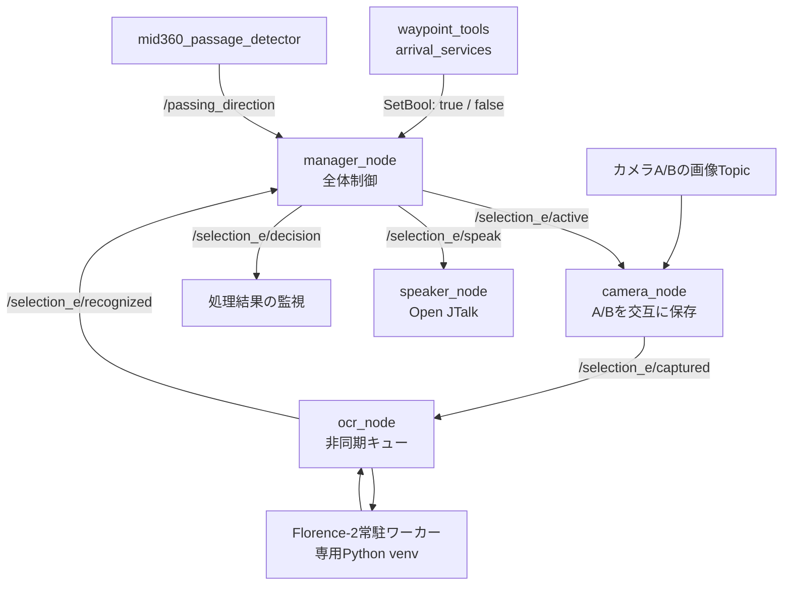

# selection_e_manager

**選択課題E向け：waypoint到着を起点に、LiDARの通過判定・カメラ撮影・Florence-2による数字認識・日本語音声読み上げを連携させるROS 2パッケージです。**

対象環境：**Ubuntu 22.04 / ROS 2 Humble**（実機での動作確認は未実施）

> このREADMEは `selection_e_integration_v0_2.zip` に含まれる `selection_e_manager` v0.2.0 のコードを基準にしています。既存の `waypoint_tools`、`mid360_passage_detector`、`florence2_work`、`tsukuba_E_speak` のソースコードは同梱・変更していません。

## 1. システム概要



- 所定のwaypointに到着すると、`arrival_services` が `/selection_e/control` を呼び出してミッションを開始します。
- ミッション実行中、`camera_node` はA/Bの最新画像を**1.5秒間隔で交互に**JPEG保存します。各カメラは3秒周期です。撮影完了を通知すると `ocr_node` が認識をキューに登録します。
- OCRは**撮影とは別ノード・別ワーカー**で実行されるため、認識中も撮影を継続します。Florence-2モデルはワーカー起動時に一度ロードし、撮影のたびに読み直しません。
- 数字認識に成功した結果を保持し、`mid360_passage_detector` の通過イベントを受けて適切な撮影時刻の結果を選びます。決定した数字をOpen JTalkで読み上げます。

### 通過方向による違い

| イベント | 使用する画像 | 読み上げタイミング |
| --- | --- | --- |
| `FRONT_TO_REAR` | 通過**前**の指定期間に認識した画像からカメラごとに直近最大3枚 | 通過後、認識待機が終わってから |
| `REAR_TO_FRONT` | 通過**後**の指定期間に認識した画像からカメラごとに直近最大3枚 | 通過後の撮影・認識待機が終わってから |

初期値：`FRONT_TO_REAR` は通過前30秒、OCR完了を最大15秒待機。`REAR_TO_FRONT` は通過後18秒間の画像を対象とし、さらに最大10秒のOCR猶予を確保します。いずれも**撮影時刻**を基準に判定し、OCRの完了時刻を撮影時刻として扱いません。

認識された数字は画像ごとに最大1票として扱い、最多票の数字が一意に決まれば採用します。`min_votes: 2` で2枚以上の一致を必須にできます。読み上げメッセージは「チーム番号は〇〇です。」です。

## 2. ディレクトリ構成

```text
selection_e_manager/
├── config/
│   └── params.yaml                # 全ノードの設定
├── examples/
│   └── waypoint_service_example.yaml
├── launch/
│   └── system.launch.py           # 4ノードの一括起動
├── resource/
│   └── selection_e_manager
├── selection_e_manager/
│   ├── __init__.py
│   ├── manager_node.py            # ミッション・通過イベントの管理
│   ├── camera_node.py             # 撮影とJPEG保存
│   ├── ocr_node.py                # OCRキュー・外部ワーカー管理
│   ├── florence_worker.py         # ROS非依存の常駐OCRワーカー
│   ├── speaker_node.py            # Open JTalk読み上げ
│   └── common.py                  # JSONイベント解析・番号選択
├── test/
│   ├── test_common.py
│   └── test_florence_worker.py
├── package.xml
├── setup.cfg
└── setup.py
```

## 3. 前提条件・依存関係

以下は**別途準備**してください。

1. ROS 2 Humbleと`colcon`を利用できるUbuntu 22.04環境。
2. `waypoint_tools` の **`add_service`ブランチ**（waypointから起動する場合）。
3. `mid360_passage_detector` と Livox MID360の点群・TF（実際の通過イベントを使う場合）。
4. `/camera/image_raw` と `/camera_b/image_raw` (`sensor_msgs/msg/Image`) を配信するカメラノード。実際のTopic名に合わせて設定してください。
5. `florence2_work/florence2_number.py` と、Florence-2を実行できる専用Python仮想環境（`torch`、`transformers`、`Pillow`、モデルファイルなど）。
6. `open_jtalk`、辞書、HTS音声モデル、`aplay`（音声を再生する場合）。

参考リポジトリ：

- [waypoint_tools — add_service](https://github.com/Shuma-s58/waypoint_tools/tree/add_service)
- [mid360_passage_detector](https://github.com/Shuma-s58/mid360_passage_detector)
- [florence2_work](https://github.com/Shuma-s58/florence2_work)
- [tsukuba_E_speak](https://github.com/Shuma-s58/tsukuba_E_speak)
- [box_mission](https://github.com/Shuma-s58/box_mission)（Florence-2を別Python環境で起動する構成の参考）

ROS 2側に必要な主なパッケージの例：

```bash
sudo apt update
sudo apt install -y \
  python3-opencv python3-pil \
  ros-humble-rclpy ros-humble-cv-bridge \
  ros-humble-sensor-msgs ros-humble-std-msgs \
  ros-humble-std-srvs ros-humble-launch-ros
```

音声を使用する場合：

```bash
sudo apt install -y \
  open-jtalk open-jtalk-mecab-naist-jdic \
  hts-voice-nitech-jp-atr503-m001 alsa-utils
```

音声モデルと辞書の実パスは環境によって異なるため、`params.yaml` と照合してください。

## 4. インストール

GitHubのリポジトリのルートが `package.xml` を含む `selection_e_manager/` になっている場合：

```bash
source /opt/ros/humble/setup.bash
mkdir -p ~/ros2_ws/src
cd ~/ros2_ws/src
git clone https://github.com/<YOUR_ACCOUNT>/selection_e_manager.git
cd ~/ros2_ws
colcon build --symlink-install --packages-select selection_e_manager
source install/setup.bash
```

`<YOUR_ACCOUNT>`は作成したGitHubリポジトリの所有者に置き換えてください。ZIPから導入する場合は、**`package.xml` のある `selection_e_manager` ディレクトリだけ**を `~/ros2_ws/src/` に配置します。

> `colcon build`はROS 2のパッケージをビルドします。Florence-2の重みファイルやPython仮想環境は自動インストールされません。

## 5. パラメータ設定

`config/params.yaml` を編集します。

### 5.1 Florence-2の自動起動とローカルモデル

```yaml
selection_e_ocr:
  ros__parameters:
    florence_python: /home/ros/florence2_work/.venv/bin/python
    florence_script: /home/ros/florence2_work/florence2_number.py
    model: /home/ros/models/Florence-2-large
    device: auto
    startup_timeout_s: 300.0
    queue_capacity: 12
    mock_mode: false
    remove_failed_images: true
```

- `florence_python`：Florence-2用仮想環境のPythonの**実際のパス**。
- `florence_script`：既存の`florence2_number.py`のパス。取り込み時には`make_regions()`を使用します。
- `model`：Hugging FaceモデルID、または**ローカルモデルディレクトリのパス**を指定可能。
- `device`：`auto` / `cuda` / `cpu`。`auto`はCUDAが使えればCUDAを選びます。
- `startup_timeout_s`：モデル起動完了までのタイムアウト（秒）。
- `queue_capacity`：処理待ちの画像通知数。上限に達すると、新規通知を破棄します。

`~/`形式もコード内で展開されますが、別ユーザー・コンテナ内で動かす場合は**絶対パス**をおすすめします。ローカルモデルの使用時も、依存パッケージ・カスタムモデルコードが揃っているか確認してください。

**モデルはROSノードの起動時に自動ロードされます。** 毎回venvを`activate`したり、`florence2_number.py`を別端末から実行したりする必要はありません。ただし、`florence_python`で指定した仮想環境そのものの作成は事前に必要です。

### 5.2 カメラと通過判定

```yaml
selection_e_camera:
  ros__parameters:
    image_topic: /camera/image_raw
    image_topic_b: /camera_b/image_raw
    capture_period_s: 3.0
    max_frame_age_s: 3.0
    output_dir: /tmp/selection_e/captures
    max_recent_files: 3
    file_retention_s: 600.0

selection_e_manager:
  ros__parameters:
    lookback_s: 30.0
    post_wait_s: 18.0
    front_ocr_grace_s: 15.0
    rear_ocr_grace_s: 10.0
    min_votes: 1
    preferred_camera: A
    dedup_s: 8.0
    result_retention_s: 120.0
    max_results: 150
    max_pending: 12
```

`max_recent_files`はカメラノードがメモリで管理する直近ファイル一覧の長さです。**撮影済みファイルを3枚に物理的に制限するパラメータではありません。** JPEGファイルの整理は`file_retention_s`などで行われます。数字認識に成功した結果のメタデータは、`result_retention_s`で設定した期間だけ管理されます。

`image_topic`はカメラA、`image_topic_b`はカメラBの入力です。両方を設定すると、ミッション開始後、A→1.5秒後にB→1.5秒後にAの順に保存します（`capture_period_s: 3.0`の場合）。両カメラはそれぞれ3秒周期です。単眼構成に戻す場合は`image_topic_b: ''`にします。`max_frame_age_s`より古い受信画像は保存せず、カメラが停止したときの画像の再利用を防ぎます。

`preferred_camera`は`A`または`B`です。各カメラの対象期間内の直近3枚の撮影結果から番号を選び、優先カメラに有効な番号があればそれを採用します。優先カメラで番号が決まらなければ、もう一方の結果を採用します。同じカメラで異なる番号が同票の場合、そのカメラでは番号を決めません。撮影通知・OCR結果・最終決定には`camera_id`が含まれます。起動後も`ros2 param set /selection_e_manager preferred_camera B`で切り替えられます。

OCRは1つのワーカーで順番に実行します。全体で1.5秒に1枚撮影するため、推論が追いつかない場合は`OCR queue full`が出て画像が破棄されます。実機でOCR所要時間と、通過後の判定待機時間を確認してください。

## 6. 起動方法

### 6.1 センサ・カメラ

先にMID360、通過判定ノード、カメラ画像配信ノードを起動してください。通過判定ノードの具体的なlaunch名は、そのリポジトリの内容を確認してください。例：

```bash
ros2 topic list | grep -E 'livox|passing_direction|camera/image_raw'
ros2 topic hz /camera/image_raw
ros2 topic hz /camera_b/image_raw
```

### 6.2 統合システム

```bash
source /opt/ros/humble/setup.bash
source ~/ros2_ws/install/setup.bash
ros2 launch selection_e_manager system.launch.py
```

別の設定ファイルを使う場合：

```bash
ros2 launch selection_e_manager system.launch.py \
  params_file:=/home/ros/my_selection_e_params.yaml
```

起動すると4ノード（`manager_node`、`camera_node`、`ocr_node`、`speaker_node`）が起動し、Florence-2専用ワーカーのモデル読み込みを開始します。ミッションの撮影処理は、次の開始指示を受けるまで待機します。

### 6.3 手動でミッション開始・停止

waypointに接続する前に単独で試せます。

```bash
# 開始
ros2 service call /selection_e/control std_srvs/srv/SetBool '{data: true}'

# 停止
ros2 service call /selection_e/control std_srvs/srv/SetBool '{data: false}'
```

## 7. waypoint_toolsとの連携

`waypoint_tools` の `add_service`ブランチにあるwaypoint YAMLへ、次のような設定を追加します（既存の項目を消さずにマージしてください）。

```yaml
arrival_services:
  E: /selection_e/control

waypoints:
  - x: 2.0
    y: 1.0
    yaw: 1.57
    on_arrival_task: E
    on_arrival_action: start

  - x: 5.0
    y: 1.0
    yaw: 0.0
    on_arrival_task: E
    on_arrival_action: stop
```

`start`で`SetBool(data=true)`、`stop`で`SetBool(data=false)`を送信します。**このパッケージはNav2への次のgoal送信を行いません。** 次のwaypointへ進む操作・条件は`waypoint_tools`側の仕様に従います。

## 8. ROS 2インターフェース

| Topic / Service | 型 | 用途 |
| --- | --- | --- |
| `/selection_e/control` | `std_srvs/srv/SetBool` | ミッション開始・停止 |
| `/selection_e/active` | `std_msgs/msg/Bool` | manager → camera・OCR の稼働フラグ |
| `/camera/image_raw`, `/camera_b/image_raw` | `sensor_msgs/msg/Image` | カメラA・Bの入力（設定で変更可） |
| `/selection_e/captured` | `std_msgs/msg/String`（JSON） | 撮影画像ID・カメラID・撮影時刻・画像パス |
| `/selection_e/recognized` | `std_msgs/msg/String`（JSON） | OCR認識結果 |
| `/selection_e/ocr_status` | `std_msgs/msg/String`（JSON） | `loading` / `ready` / `error`等 |
| `/passing_direction` | `std_msgs/msg/String`（JSON） | 通過方向・対象ID |
| `/selection_e/speak` | `std_msgs/msg/String` | 読み上げる数字 |
| `/selection_e/decision` | `std_msgs/msg/String`（JSON） | 採用結果・処理状態 |

**ログ確認**：

```bash
ros2 topic echo /selection_e/ocr_status
ros2 topic echo /selection_e/active
ros2 topic echo /selection_e/captured
ros2 topic echo /selection_e/recognized
ros2 topic echo /selection_e/decision
```

`/selection_e/ocr_status`に`"state": "ready"`が出れば、OCRワーカーが利用可能な状態です。`/selection_e/decision`の`"status": "spoken"`は**読み上げTopicへ番号を送信した**という意味で、実際の音声再生完了を保証するものではありません。

## 9. 動作確認

### 9.1 OCR・カメラ・音声なしのロジック確認

`params.yaml`で以下を設定してから起動します。

```yaml
selection_e_ocr:
  ros__parameters:
    mock_mode: true

selection_e_speaker:
  ros__parameters:
    dry_run: true
```

`/selection_e/control`を`true`にしたうえで、撮影通知と通過イベントを手動で送信できます。モックOCRは画像ファイル名に`_num25_`が含まれると数字`25`を返す仕様です。

ただし、`captured_at`には**現在のROS時計の秒単位時刻**が必要です。古い固定時刻を入れると開始時刻フィルタで除外されます。以下のコマンドでは、実際の環境の時刻を使用してください。

```bash
STAMP=$(python3 -c 'import time; print(time.time())')
ros2 topic pub --once /selection_e/captured std_msgs/msg/String \
  "{data: '{\"image_id\":\"test_num25_01\",\"captured_at\":${STAMP},\"image_path\":\"/tmp/test_num25_.jpg\"}'}"

ros2 topic pub --once /passing_direction std_msgs/msg/String \
  '{data: "{\"direction\":\"FRONT_TO_REAR\",\"track_id\":1}"}'
```

`FRONT_TO_REAR`では**通過前の撮影時刻**の認識結果が必要です。`REAR_TO_FRONT`では、通過イベントの後に撮影通知を送ってください。`mock_mode` / `dry_run` は本番前に必ず`false`へ戻します。

### 9.2 実カメラ・実モデルでの確認

1. `ros2 topic hz /camera/image_raw`と`ros2 topic hz /camera_b/image_raw`で両カメラの画像を確認します。
2. `ros2 launch selection_e_manager system.launch.py`でモデルが自動起動し、`/selection_e/ocr_status`が`ready`になることを確認します。
3. `/selection_e/control`を`true`にします。
4. `/selection_e/captured`が約1.5秒間隔で更新され、`camera_id`が`A`と`B`で交互になることを確認します。
5. 数字が書かれた対象をカメラに映し、`/selection_e/recognized`を確認します。
6. `FRONT_TO_REAR`または`REAR_TO_FRONT`イベントを発行し、`/selection_e/decision`と音声を確認します。
7. `/selection_e/control`を`false`にして撮影が止まることを確認します。

### 9.3 Python単体テスト

ROS 2なしで実行可能な部分は次で確認できます（`pytest`が必要です）。

```bash
cd ~/ros2_ws/src/selection_e_manager
python3 -m pytest -q test/
```

## 10. 注意事項・既知の制限

- **単一対象物を前提とした初期実装**です。LiDAR追跡IDと、カメラ画像のどの数字が同じ物体に属するかの対応付けは未実装です。複数物体が同時に見える環境では誤判定する可能性があります。
- `/passing_direction`の判定は相対的な通過方向です。自機移動中の静止物体などについては別途検証が必要です。
- カメラは外部Topicの**最新フレーム**を交互に保存します。カメラシャッターをハードウェア制御する実装ではありません。
- OCRの推論速度が撮影より遅く、キューが満杯になると新しいOCR要求を破棄します。**撮影自体は継続**します。
- `REAR_TO_FRONT`の読み上げは、通過後の画像収集時間とOCR猶予の分だけ遅れます。番号が写らなければ読み上げません。
- 成功したOCR結果は保存・参照しますが、**画像上の数字とLiDAR追跡IDの厳密な関連付けや、無制限の長期保存はしていません**。画像ファイルは初期設定で600秒経過後に削除され得ます。
- 現実装でOCR失敗した画像は`remove_failed_images: true`なら処理後に削除されます。
- `FRONT_TO_REAR`では、両カメラの直近3枚ずつについてOCR成功・失敗の完了を待ちます。キューから破棄された画像は完了通知がないため、OCR猶予時間まで待機する場合があります。
- 既存の4リポジトリをこのパッケージが自動で起動するわけではありません。**Florence-2ワーカーの自動起動**と、MID360通過判定ノード・カメラドライバの起動は別です。
- この作成環境ではROS 2 Humble実機でのビルド・統合動作検証は行っていません。初回利用時は音量、カメラ方向、モデル互換性、TF、通過判定を確認してください。

## 11. 開発・改善候補

- カメラ検出bboxとLiDAR追跡IDの紐付け
- 通過イベントごとのOCR成功率と処理時間の記録
- OCRキューの遅延監視・最新フレーム優先などの過負荷対策
- 音声再生完了通知と再試行
- Nav2走行中の自己移動を考慮した通過判定
- カメラ画像・OCR結果・通過イベントの時刻同期とbag検証

---

**バージョン**：0.2.0  
**対象**：ROS 2 Humble / Ubuntu 22.04  
**検証状況**：構文・一部ROS非依存テストのみ確認。実機統合動作は未検証。

